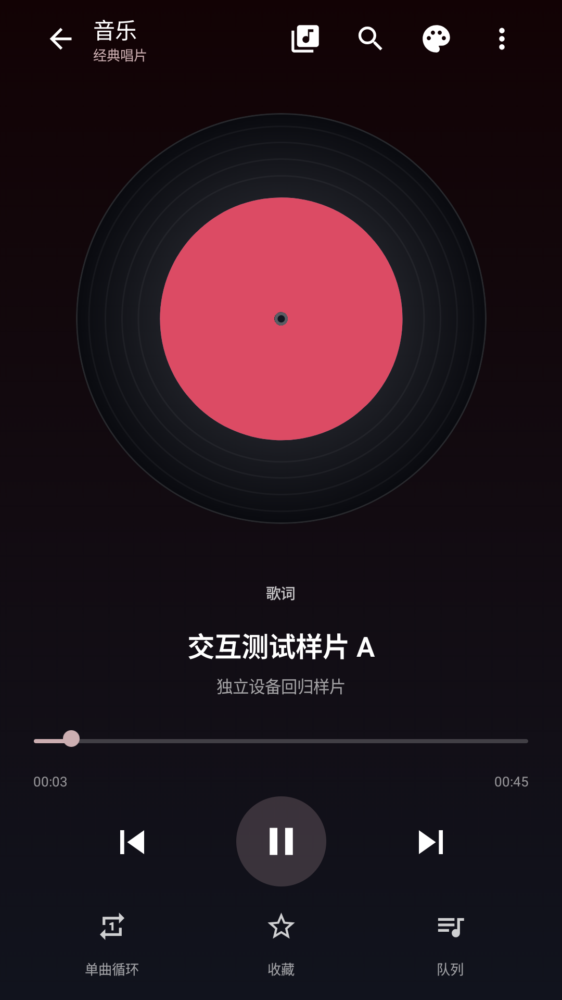
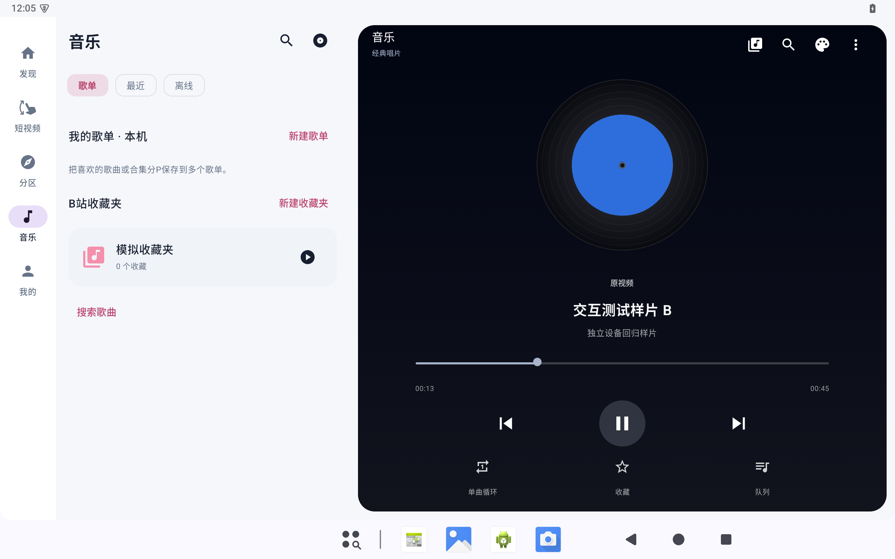

<div align="center">
  
  <h1>BiliDesk Android</h1>
  <p>看视频，也听音乐。为手机与平板打造的原生 Android 第三方 B站客户端。</p>
  <p>
    <a href="https://github.com/greyzhang491/BiliDesk-Android/actions/workflows/android.yml"></a>
    <a href="LICENSE"></a>
    
    <a href="https://github.com/greyzhang491/BiliDesk-Android/releases/tag/v0.1.7"></a>
  </p>
  <p>
    <a href="https://github.com/greyzhang491/BiliDesk-Android/releases/tag/v0.1.7">下载安装</a> ·
    <a href="docs/USAGE.pdf">使用说明</a> ·
    <a href="docs/ARCHITECTURE.md">代码导览</a> ·
    <a href="CONTRIBUTING.md">参与开发</a> ·
    <a href="https://github.com/greyzhang491/BiliDesk-Android/issues/new/choose">反馈问题</a>
  </p>
</div>

参考并移植 [ABING1111/BiliDesk](https://github.com/ABING1111/BiliDesk) 的核心逻辑，以 **Kotlin + Jetpack Compose + Media3** 实现手机手势、平板布局、音乐队列与离线缓存。上游作者、参考提交、图标来源与移植映射保留在 [NOTICE](NOTICE.md)。

> **独立、非官方的开发预览项目**，与哔哩哔哩及上游作者没有官方关联或背书。使用、修改与分发前请阅读 [免责声明](DISCLAIMER.md)、[隐私说明](PRIVACY.md) 和 [GPL-3.0 许可](LICENSE)。开源许可适用于代码，不授予平台视频、音乐、字幕或商标的使用权。

## 界面预览

<table>
  <tr>
    <td align="center" width="27%"><br>手机 · 唱片播放</td>
    <td align="center" width="73%"><br>平板 · 横屏双栏</td>
  </tr>
</table>

截图使用测试账号、独立样片和占位封面，用于展示布局，不代表真实用户收藏或平台曲库。

## 下载与上手

1. 打开 [v0.1.7 Releases](https://github.com/greyzhang491/BiliDesk-Android/releases/tag/v0.1.7)，下载 `BiliDesk-Android-0.1.7-preview.apk`。要求 **Android 8.0 或以上**。
2. 如需账号内容，使用应用内的官方扫码或网页登录；不要向项目维护者提供密码、Cookie 或登录令牌。
3. 在「音乐」中选择收藏夹作为歌单，或搜索视频后立即播放、设为下一首、加入队列。

| 想了解什么 | 从这里开始 |
| --- | --- |
| 播放、手势、音乐和缓存怎么用 | [10页 PDF 使用说明](docs/USAGE.pdf) · [离线 HTML 说明](docs/USAGE.html)（下载后打开） |
| 这一版更新了什么 | [0.1.7 登录恢复补充](docs/RELEASE-0.1.7.md) · [变更记录](CHANGELOG.md) |
| 如何编译、调试和提交修改 | [构建说明](docs/BUILD.md) · [开发指南](docs/DEVELOPMENT.md) · [贡献指南](CONTRIBUTING.md) |

Release 中的预览 APK 与此前交付的 0.1.6 使用相同证书，可覆盖更新并保留数据。**Actions 构建包使用运行环境的临时调试证书，不能保证覆盖安装 Release 版本**。日常使用请选择 Release 附件；附件的 SHA256 校验值见同页 `SHA256SUMS.txt`。

## 功能一览

| 板块 | 已实现 |
| --- | --- |
| 发现与搜索 | 推荐、热门、排行榜、分区；关键词与 BV/AV/链接搜索；下拉刷新、自动分页、卡片密度和列数 |
| 视频播放 | DASH 音视频、分P、清晰度与线路、倍速、全屏、画中画、后台听视频 |
| 播放手势 | 双击快进退、长按倍速、长按横滑调进度；横屏左侧亮度、右侧音量 |
| 短视频模式 | 普通长短视频上下滑连播；点赞、评论、收藏、分享；倍率选择和锁定；评论时继续播放；横屏使用常规控件 |
| 音乐模式 | 收藏夹歌单、搜歌、下一首、队列；顺序/列表循环/单曲/随机；旋转唱片、封面取色、字幕歌词或原视频、小播放条、后台控制 |
| 弹幕 | 滚动/顶部/底部、透明度、区域、字号、速度、去重和屏蔽词；播放中即时调整 |
| 离线与存储 | 实际可用画质、视频或音频选择；分段续传、暂停继续、恢复任务和合流；自动缓存限额与过期清理 |
| 账号与平板 | 官方扫码/网页登录、保存登录与断网重连恢复、收藏、历史、稍后再看、追番、消息入口；侧边导航、横屏双栏、全屏与分屏适配 |

音乐入口替代动态。歌词来自视频可读取的字幕，不自动生成；没有字幕时，点唱片显示原视频。短视频模式复用普通推荐和当前列表，未接入官方私有 Story 流。

## 缓存会自动清理吗

会。**自动缓存默认关闭**；开启后仅在不超过3分钟的视频播完时尝试保存，默认 **256MB / 7天未播放**，并限制为非计费 Wi-Fi。

应用启动、自动缓存前后、修改限制和停止本地播放时检查，优先删除最久未播放的自动缓存。正在播放的文件受保护，手动下载的视频与歌曲单独保留。应用完全关闭时不会准点后台清理，下次触发检查时处理。

256MB 约束自动缓存，不能代表应用总占用：手动下载、未完成任务、图片和字幕另外占空间。图片缓存上限64MB，字幕缓存上限8MB。完整规则见使用说明第8页及 [隐私说明](PRIVACY.md)。

## 从源码开始

需要 **JDK 17、Android SDK Platform 35、Build Tools 35.0.0**。Gradle Wrapper 固定8.11.1并校验发行包。

```bash
./gradlew assembleDebug testDebugUnitTest lintDebug assembleDebugAndroidTest
```

Windows 使用 `gradlew.bat`。首次构建需要下载依赖；连接受限时可显式加 `-PuseChinaMirrors=true`。详见 [构建说明](docs/BUILD.md)。

当前工程采用**单个 Gradle `app` 模块，按职责划分 Kotlin 包**。每个包附有入口说明，便于先找到修改位置，再决定是否拆分模块。

| 职责 | 源码入口 | 维护说明 |
| --- | --- | --- |
| 应用装配与生命周期 | [BiliDeskApplication.kt](app/src/main/java/dev/bilidesk/android/BiliDeskApplication.kt)、[MainActivity.kt](app/src/main/java/dev/bilidesk/android/MainActivity.kt) | [整体架构与数据流](docs/ARCHITECTURE.md) |
| API、凭据、存储与纯策略 | [data/](app/src/main/java/dev/bilidesk/android/data) | [data 导览](app/src/main/java/dev/bilidesk/android/data/README.md) |
| 播放、音乐队列、弹幕和媒体服务 | [player/](app/src/main/java/dev/bilidesk/android/player) | [player 导览](app/src/main/java/dev/bilidesk/android/player/README.md) |
| 下载队列、断点续传与合流 | [download/](app/src/main/java/dev/bilidesk/android/download) | [download 导览](app/src/main/java/dev/bilidesk/android/download/README.md) |
| Compose 页面、自适应布局与手势 | [ui/](app/src/main/java/dev/bilidesk/android/ui) | [ui 导览](app/src/main/java/dev/bilidesk/android/ui/README.md) |
| 单元测试与设备交互验证 | [JVM 测试](app/src/test/java/dev/bilidesk/android)、[设备测试方法](validation/INTERACTION_TESTS.md) | [验证记录与边界](docs/VALIDATION-0.1.6.md) |

欢迎提交 [Issue](https://github.com/greyzhang491/BiliDesk-Android/issues/new/choose) 或 Pull Request。新贡献请先阅读 [CONTRIBUTING](CONTRIBUTING.md)；账号或凭据泄露问题请按 [SECURITY](SECURITY.md) 私下报告。

## 验证与已知限制

0.1.7 修复离线启动与断网重连后误判未登录的问题，新增登录恢复回归。步骤与边界见 [0.1.7 验证说明](docs/VALIDATION-0.1.7.md)、[验证摘要](validation/interaction-checks-0.1.7.json) 和 [当前源码清单](validation/source-integrity-0.1.7.json)。以下保留0.1.6功能验证基线。

0.1.6 的本地构建通过78项 JVM 测试，Lint 0错误/31警告；手机11项、平板5项模拟器交互场景按同一最终 APK 分次通过。测试使用独立样片、本地模拟接口和模拟账号，实际检查解码、媒体控制、手势、布局、缓存轨道及断点恢复。仓库顶部徽章反映最新 Actions 状态，原始失败及后续修复可在运行记录中追溯。

**本轮尚未完成新增的真实B站在线播放、字幕接口和 CDN 下载验收**，也未新增红米 K60 / 小米平板6 物理设备验证。没有真实账号扣币或互动写入验证。平台登录、会员、地域与内容权限始终生效。

高级/BAS弹幕、直播实时弹幕及官方客户端全部管理操作尚未覆盖。测试结果和限制分别保存在 [验证摘要](validation/interaction-checks-0.1.6.json)、[源码一致性清单](validation/source-integrity-0.1.6.json) 和 [详细说明](docs/VALIDATION-0.1.6.md)。

## 许可与致谢

代码按 **GPL-3.0-only** 开源。修改与再分发须遵守 [LICENSE](LICENSE)，保留原作者与来源，并按许可提供对应源码。此许可不改变第三方内容、图片、商标或依赖的权利归属。免责声明不增加“禁止商用”等与 GPL 冲突的条件，也不保证免除法律责任，详见 [DISCLAIMER](DISCLAIMER.md)。

感谢 [ABING1111/BiliDesk](https://github.com/ABING1111/BiliDesk) 的原始实现。文档导航与职责说明参考 [Now in Android](https://github.com/android/nowinandroid) 的学习导览，项目首页的下载、预览与参与入口参考 [NewPipe](https://github.com/TeamNewPipe/NewPipe) 的组织方式；不表示与这些项目存在合作或背书。第三方依赖和图标来源见 [NOTICE](NOTICE.md)。
