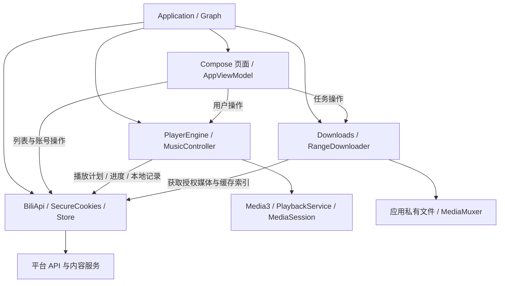

# 架构与代码导览

[文档首页](README.md) · [开发指南](DEVELOPMENT.md) · [构建说明](BUILD.md)

## 当前组织方式

项目采用单个 Android Gradle `app` 模块，以 Kotlin 包区分数据、播放、下载与界面职责。`BiliDeskApplication` 中的 `Graph` 手动装配并持有共享对象。页面与服务复用同一个播放器，以保持视频、音乐、小播放条和系统媒体控制之间的连续性。

当前没有独立 domain 层、依赖注入框架或按功能拆开的 Gradle 模块。部分页面直接通过 `Graph` 访问 API 和存储，因此包图表示主要协作关系，不是编译器强制的单向依赖约束。



## 目录与入口

```text
app/
  src/main/java/dev/bilidesk/android/
    BiliDeskApplication.kt   # 依赖装配与图片缓存
    MainActivity.kt          # Activity、外部链接、系统窗口与生命周期
    data/                   # API、凭据、模型、存储和可测试策略
    player/                 # 播放引擎、音乐队列、弹幕和媒体服务
    sync/                   # 可选加密同步、设备快照、合并与联网补传
    download/               # 下载任务、Range 传输、合流和下载服务
    ui/                     # Compose 页面、布局策略、手势和视图模型
  src/test/                 # 本地 JVM 单元测试与模拟 HTTP 服务
  src/androidTest/          # Android 设备交互测试与独立夹具
docs/                       # 用户文档与维护文档
validation/                 # 脱敏验证摘要和源码校验清单
.github/                    # CI、Issue 和 PR 模板
```

各包的 [data](../app/src/main/java/dev/bilidesk/android/data/README.md)、[player](../app/src/main/java/dev/bilidesk/android/player/README.md)、[download](../app/src/main/java/dev/bilidesk/android/download/README.md)、[ui](../app/src/main/java/dev/bilidesk/android/ui/README.md) 导览给出具体文件与修改约束。

## 关键路径

### 推荐、搜索与刷新

`BiliApp` 的列表界面调用 `VideoFeedPager` 和 `BiliApi` 读取数据。Pager 管理追加、刷新、去重与未见内容优先；刷新等待已在进行的追加请求，再重置位置。平台没有新内容时应明确提示，不能靠随机排序旧列表伪造新推荐。

### 视频与音乐共用播放器

`AppViewModel.openVideo` / `playMusic` 将用户选择交给 `PlayerEngine`。引擎读取视频详情、分P与实际授权的 `PlayPlan`，准备 Media3 音视频源，并通过 `StateFlow` 提供状态。`MusicController` 与 `MusicQueue` 管理音乐队列、下一首优先及播放模式；`MusicSessionPlayer` 把系统上一首/下一首命令接入音乐逻辑。

唱片、歌词或原视频是同一音乐会话的不同展示方式。0.2.5的原视频使用按需独立静音画面播放器跟随主音频时钟，避免切源打断；切换展示不重置当前曲目的进度。字幕只能来自可读取的视频字幕；没有歌词时显示状态，原视频由用户主动选择。

0.1.8将纯音乐切换为真正的单音轨媒体源，跳过视频CDN测速；原视频按显式用户操作附加，保留主音轨媒体项与位置，切换时可能缓冲。`MusicAudioPolicy`按实际可用音轨选择码率，`MusicPreferences`保存外观与音质。`MusicLibrary`在独立偏好文件中串行确认保存多个本机歌单，编辑歌单不替换`MusicQueueState`；歌曲身份包含视频与cid。`MusicPlaylists`负责合集／多P选择和歌单编辑，`MusicAppearance`负责播放器DIY。

### 离线下载与存储策略

`DownloadOptions` 选择账号实际可用的画质与视频/音频类型，`Downloads` 维护任务及前台下载服务。`RangeDownloader` 按有界 Range 下载，保存部分文件和 `.resume` 元数据；`Downloads` 使用系统 `MediaExtractor` / `MediaMuxer` 处理轨道，完成后写入 `Store` 的缓存索引。

`CachePolicy` 是自动缓存淘汰策略，`Store` 执行索引和文件更新。手动下载、自动缓存和播放中的文件有不同保护规则；容量上限不能误用为全部私有数据的总上限。详见 [隐私与缓存说明](../PRIVACY.md)。

### 登录与账号操作

`AccountScreens` 提供官方扫码或网页登录；`SecureCookies` 限定会话 Cookie 的域名和本机加密存储。`AccountWriteClient` 统一处理账号写请求与错误说明。播放历史也会自动尝试同步，具体网络行为见 [PRIVACY](../PRIVACY.md)。不要把登录密钥、账号数据或完整响应写入诊断日志。

0.1.7增加 `AccountSession` 管理账号验证状态，`SecureCookies` 加密保存并绑定上次已验证的资料。`MainActivity` 仅在前台收集 `AccountNetworkMonitor` 的事件，重连后触发有界的只读校验；网络异常保留账号，导航明确拒绝才要求重新登录。退出或切换会话通过代次与会话指纹隔离迟到结果，不能由旧请求恢复已退出的账号。

0.1.8的`SocialModels`解析关系、评论／回复和合集数据；`AccountActions`提供有读取／错误／提交状态的关注按钮与收藏夹创建；`VideoComments`在两种视频布局共用，不持有或替换播放器。全局最早评论从服务器末页开始，点赞以rpid跟踪。新增账号写入仍复用`AccountWriteClient`，禁止自动重放和透明重定向。

0.2.1将富文本／用户模型放入`CommentContent`，头像、等级、表情和原图由`CommentComponents`呈现。`VideoComments`按排序和线程持有分页及滚动状态；发表回复只失效所属线程，主列表和其他线程保持位置。`CreatorScreen`通过完整窗口Dialog显示公开资料与投稿，关闭时保留下面的评论composition；仅选择另一条投稿才切换同一个播放器。已知提及UID直接导航，昵称检索缺少可靠映射时展示候选，不从姓名猜测UID。

## 维护原则

- Android 生命周期、后台服务、媒体会话和下载取消必须实际释放资源；界面离开与播放停止是不同事件。
- 可独立计算的队列、布局、分页和缓存规则优先保持为可在 JVM 验证的逻辑；系统解码、绘制与触摸仍需设备测试。
- 先按职责放置新代码，避免继续扩大单个页面文件；有清晰接口和构建需求后，再单独评估 Gradle 模块拆分。
- 首次0.1.6公开整理只增加导览、贡献约定与配置，并修正一个测试的回环地址；该版本清单保留为历史基线。0.1.7的运行代码变更及验证另见登录恢复说明和对应版本源码清单。

文档写法参考 [Now in Android 的架构学习导览](https://github.com/android/nowinandroid/blob/main/docs/ArchitectureLearningJourney.md)，但本工程的实际结构以上述源码为准。

## 可选云同步与浮动播放

`MusicSync`观察本机歌单、队列与播放器操作，使用`SyncModel`产生逐项修订和每设备原子队列快照。`SyncCrypto`以随机恢复密钥压缩并认证加密白名单元数据，`WebDavSync`限制在固定HTTPS服务的专用子目录。授权由`SyncSecrets`经Android Keystore保护。`AutoSyncPolicy`区分本机保存与请求上传，`SyncUploadWorker`只补传已请求的更新。详细约束见[sync导览](../app/src/main/java/dev/bilidesk/android/sync/README.md)。

`CreatorFloatingVideo`只重挂载已有视频画面，`FloatingVideoGeometry`处理位置、比例与缩放边界。双击根据来源会话返回普通或短视频路由；主页打开、移动和缩放均不能替换当前视频的MediaItem。
